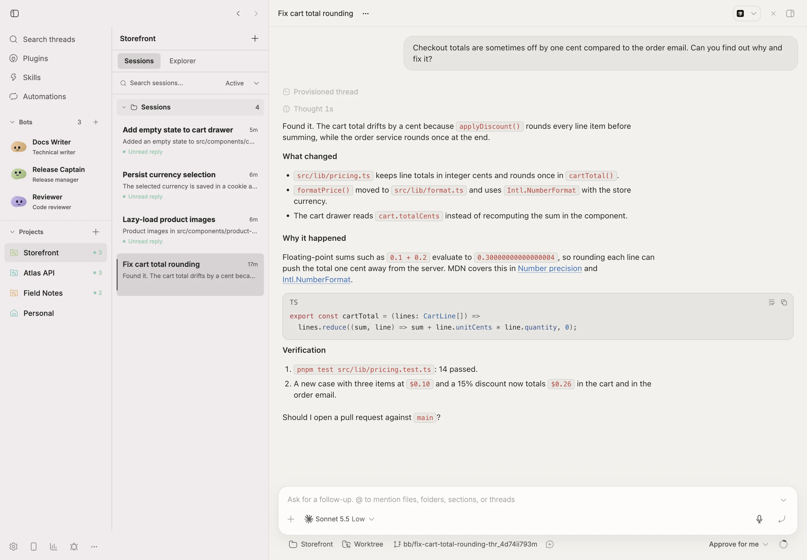
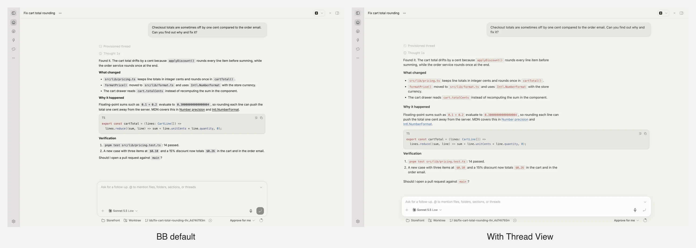
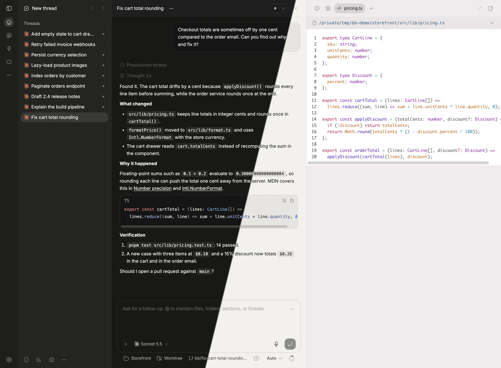
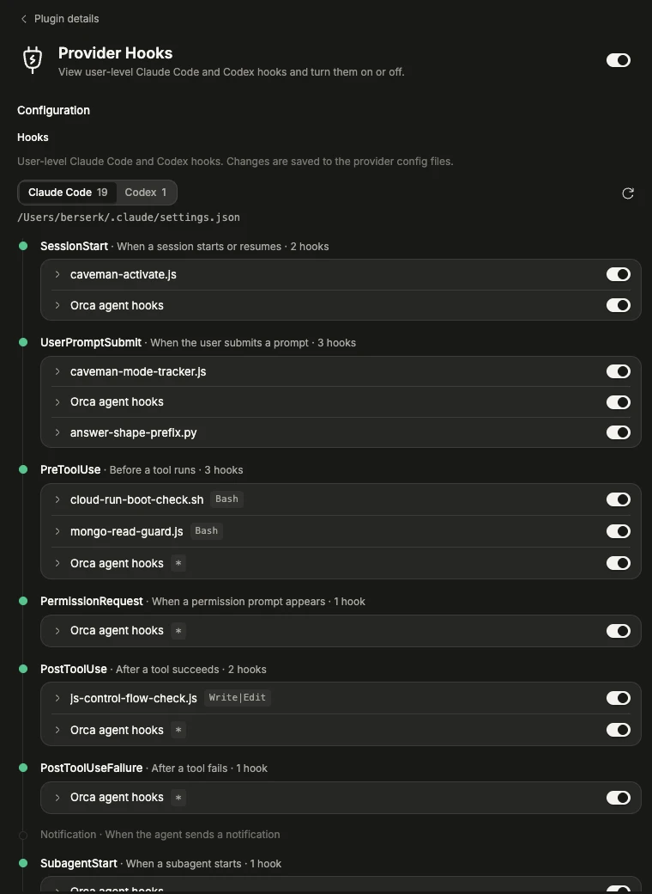

# bb-plugins

Vasyl Dobrovolskyi's [BB](https://getbb.app) plugins, in one repository. Every plugin lives under `plugins/<id>/` as an ordinary plugin package with its own `package.json`, `.bb/plugins.json` indexes them as a collection, and `marketplace.json` lists them as a custom marketplace.

## Plugins

### [Project Workspace](plugins/project-workspace)

Adds a project rail with each project's Sessions, a read-only file Explorer, and reusable bot profiles, while the chat stays native BB.

<picture>
  <source media="(prefers-color-scheme: dark)" srcset="screenshots/project-workspace/sessions-dark.webp">
  
</picture>

### [Thread View](plugins/thread-view)

Widens the thread, softens reply typography, and slims the prompt box with quiet Send controls.

<picture>
  <source media="(prefers-color-scheme: dark)" srcset="screenshots/thread-view/compare-dark.webp">
  
</picture>

### [Graphite](plugins/graphite)

Recolors BB in neutral graphite greys for light and dark mode, with sticky headers that blur what scrolls under them.



### [Fast Mode Memory](plugins/fast-mode-memory)

Remembers each thread's Fast mode choice per model across thread switches and app reloads. It adds no controls of its own.


### [Provider Hooks](plugins/provider-hooks)

Lists your user-level Claude Code and Codex hooks on a lifecycle timeline, one provider at a time, and turns each hook on or off.



## Install

Add the marketplace once, then install plugins from **Plugins** in BB or by catalog entry:

```sh
bb marketplace add git:https://github.com/bxr5xrk/bb-plugins.git@main
bb plugin install thread-view@bxr5xrk
```

Or install one plugin straight from the repository:

```sh
bb plugin install git:https://github.com/bxr5xrk/bb-plugins.git@main --plugin thread-view
```

Or pin a semver range over that plugin's release tags:

```sh
bb plugin install git:https://github.com/bxr5xrk/bb-plugins.git@^0.1.0 --subdirectory plugins/thread-view --tag-prefix thread-view/
```

Graphite ships a theme, so activate it after installing:

```sh
bb theme set plugin:graphite:graphite
```

## Restore everything on a new machine

```sh
for id in graphite thread-view project-workspace fast-mode-memory provider-hooks; do
  bb plugin install git:https://github.com/bxr5xrk/bb-plugins.git@main --plugin "$id" --yes
done
bb theme set plugin:graphite:graphite
```

To work on a plugin locally, install its directory instead: `bb plugin install ./plugins/<id> --yes`, then `npm run build && bb plugin reload <id>` after each edit. Installing a new path over an existing plugin keeps its settings; `bb plugin remove` deletes them.

## Releases

Each plugin is versioned and tagged on its own as `<id>/vX.Y.Z` (for example `thread-view/v0.1.0`). Bump the plugin's `package.json` version, commit, then tag that commit with the matching prefix and push the tag.

## Development

Each plugin directory is self-contained: run `npm ci` inside it, then `npm run typecheck`, `npm test`, or `npm run build` as its `package.json` defines. `npm run build` needs the `bb` CLI (`npm install --global bb-app`).

## When BB updates

Graphite sets theme tokens, which BB supports through `bb.themes`, plus a header blur on one BB class. Thread View styles BB's own DOM, and Project Workspace also hides and drives parts of BB's shell. BB has no stable contract for that markup, so a release can rename an attribute or class and quietly undo a style.

[`scripts/check-selectors.mjs`](scripts/check-selectors.mjs) lists every BB attribute, test id, and class name the plugins depend on and looks each one up in the published `bb-app` bundle:

```sh
node scripts/check-selectors.mjs            # latest bb-app on npm
node scripts/check-selectors.mjs 0.47.0     # a specific version
node scripts/check-selectors.mjs /Applications/bb.app/Contents/Resources/app.asar.unpacked/node_modules/bb-app/app/dist/assets
```

CI runs it, together with typecheck, tests, and a build of every plugin against the latest `bb-app`, on every push and every Monday. A red `selectors` job names the plugin and the selector that disappeared; find its replacement in the new bundle, update the plugin CSS and the list, and release a patch.

A selector can survive while BB moves its element, so the lookup stays green while a plugin breaks. [`scripts/smoke-bb.mjs`](scripts/smoke-bb.mjs) catches that: it opens your running BB in headless Chrome and checks Project Workspace's sidebar, footer, Settings, and footer popups at two widths:

```sh
node scripts/smoke-bb.mjs   # needs Google Chrome and a running BB; prints PASS/FAIL and a screenshots folder
```

The [`bb-update`](.claude/skills/bb-update/SKILL.md) skill runs both checks after a BB update, repairs what broke, and re-checks.

## License

[MIT](LICENSE).
