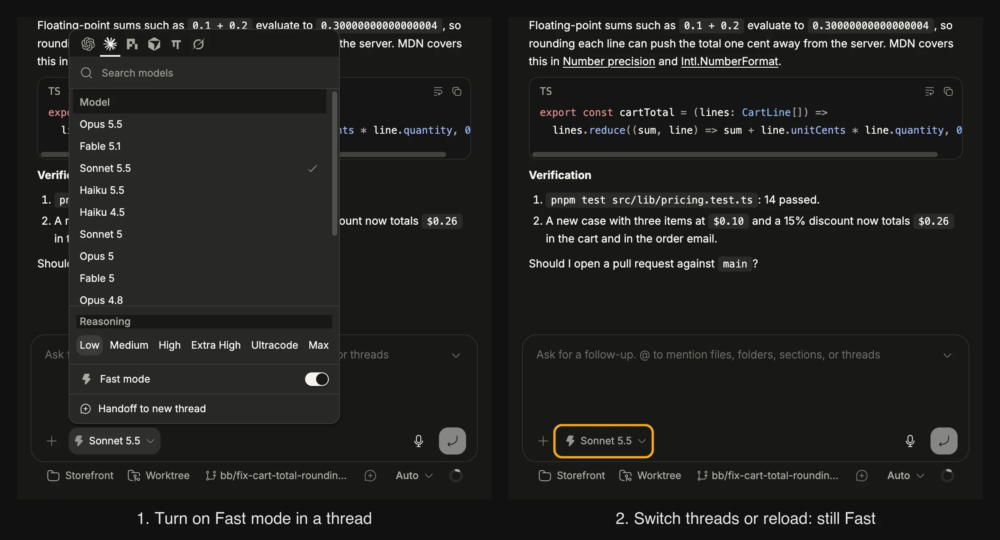

# Fast Mode Memory

A local BB plugin that remembers service-tier selections for existing thread composers. It fixes losing an unsent Fast mode choice when leaving a thread and returning.



## Behavior

- Saves a changed service tier per thread, provider, and model.
- Restores that tier through the public composer `setSelection` API on navigation and reload.
- Saves explicit Fast-off choices too.
- Leaves native model, reasoning, permissions, draft, and submission behavior intact.
- Adds no visible controls. Root new-thread, queued-message, and sent-message editors are excluded.

Storage is browser/app localStorage, namespaced by plugin ID. Different browsers, desktop profiles, and origins have separate preferences; preferences do not sync between devices. BB reconciles unsupported tiers with its native defaults. Disabling the plugin returns to BB's native behavior.

## Build and install

```sh
npm install
npm run test
npm run typecheck
bb plugin types --check
bb plugin build
bb plugin install . --yes
```

After edits, build and run `bb plugin reload fast-mode-memory`. To disable: `bb plugin disable fast-mode-memory`.

Requires BB >=0.45 and Plugin SDK >=0.6.15. Uses `experimental_appOverlay`, `useComposers`, and `setSelection`; future SDK changes may require an update. BB's installed app files are not patched.

## Verified 2026-10-09

Live BB browser: unsent Fast-on survives navigation to another thread and back, and a page reload. Neighboring thread remains default. Model A Fast-on and model B Fast-off restore independently when switching between them. Fast-off and native provider fallback are covered by focused checks. No inference message was submitted during verification.
