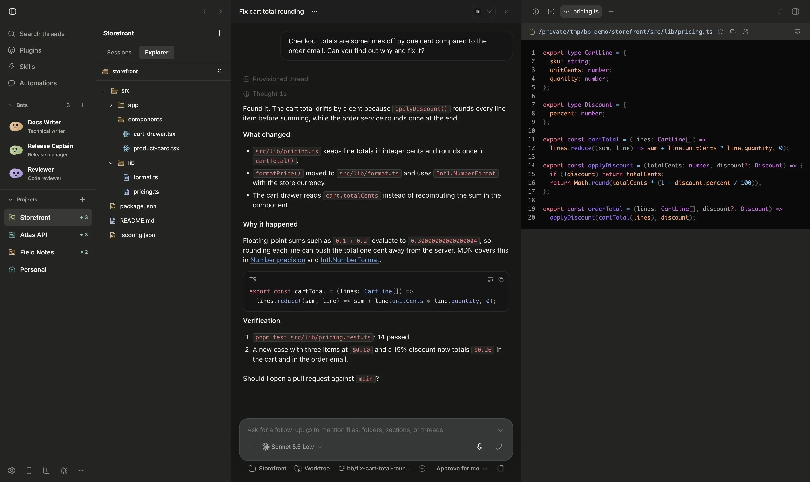
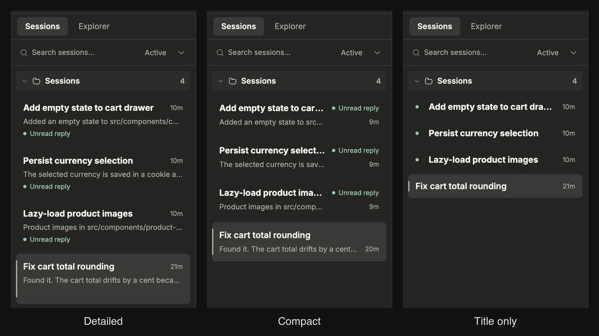

# Project Workspace for BB

A switchable project-first sidebar inspired by MonoCode: projects on the left,
selected-project sessions beside them, and an Explorer tab that opens files in
BB's existing preview. BB continues to own the conversation, composer, providers,
permissions, attachments, tools, live output, footer and right panels.

<picture>
  <source media="(prefers-color-scheme: dark)" srcset="../../screenshots/project-workspace/sessions-dark.webp">
  
</picture>

| Explorer with BB's file preview | Session cards: Detailed, Compact, Title only |
| --- | --- |
|  |  |

## Switch views

Enable this plugin, open its configuration in BB Settings → Plugins → Project
Workspace, and choose **Workspace**. Choose **Default BB** in the same section
to restore the bundled Thread list and native navigation. The thread-list
provider also appears in Settings → Appearance. Switching a project filters
only the adjacent sidebar; it does not interrupt or replace the current chat.

The Workspace button selects `project-workspace/workspace`; Default BB selects
`thread-list/thread-list`. Writes use the preference's current revision and do
not overwrite concurrent changes. BB 0.46 removed the separate navigation
provider preference. Desktop Workspace now restores labelled navigation through
ordinary activation of BB's rendered navigation controls, with conditional,
disposable shell CSS. Search, routes and keyboard shortcuts stay host-owned.

## Sessions

Settings → Plugins → Project Workspace → **Session cards** picks how much each card in the Sessions list shows. Each choice is a button with a live sample card rendered by the same CSS as the list: **Detailed** (default; title, last message and status on separate lines, 80 px rows), **Compact** (status beside the title, time beside the last message, 64 px rows) and **Title only** (title and time with a status dot, 40 px rows). The value is the `sessionCards` plugin setting (`detailed`, `compact`, `title-only`), so `bb plugin config project-workspace set sessionCards compact` works too. WindowedSessions reads the setting for row height, section height and scroll offsets. Title only hides the preview and visible status text; the status tooltip and accessibility text remain.

The project rail includes Personal workspace and real projects with no sessions.
Sessions have project-local search, pins, recency, drafts,
live runtime state, read state and BB shortcut markers. Branch/workspace metadata,
provider/model identities and quiet Idle labels/icons are omitted. Titles retain
equal 10px inline insets. Working is a blue spinner; need-input is amber; errors
red; finished unread replies green; draft/goal state violet. Text accompanies color.
Opening a session explicitly marks it read through BB. The focused, visible active chat
acknowledges subsequent unread replies, including when its row is outside the
virtual window, and reports read failures with retry. No local-only unread mask.

Projects prioritize need-input, execution/queue/host-wait, finished unread replies
or errors, then quiet conversations. Sessions use this priority inside each group;
Pinned comes first, then existing custom sections and unsectioned Sessions. Pins
retain their saved order. Projects show simultaneous colored activity counts;
quiet projects have no badge. Queued work is static. Pending interactions distinguish
questions and permissions through the public API, with an honest generic fallback.
A saved goal alone never spins. Right-click or Shift+F10 opens the native-compatible
session actions: open/split, pin, read, rename, archive and confirmed deletion.
Hidden helper threads stay hidden; long lists remain windowed. Project context
menus offer New session, Project settings and reversible client-local Hide from list.
Hidden projects can be restored without deleting any project data.

Use **+** beside **Projects** to add a real project with name, machine and absolute
folder path. Submission uses `sdk.projects.create`; errors retain input and allow
retry. This creates project metadata, not a new agent conversation or repository.

**Active** uses BB's uncapped active-thread cache. **All** and **Archived** opt
into the archive query. Archives load in pages, with explicit loading/error and
“Load more archived sessions” controls; the view does not claim unrequested
archive pages have been loaded. Search operates on the loaded session pages.

## Bots and navigation

Labelled native BB destinations now live in the left rail. The global new-thread
control and duplicate all-destinations overflow were removed; the project-local
new-session control remains. Hidden destinations have their own disclosure.

**Bots** are reusable global specialist profiles, independent of a single chat.
Use **+** beside Bots to create one manually or from an actual installed skill.
Set name, short role, Pebble mascot/color, full instructions, separate SOUL.md personality, shared rules
and optional native provider/model/reasoning defaults. Skill import copies the
selected version into an editable profile; it never writes the source skill.
Renaming keeps the immutable ID and existing chat bindings.

Right-click a bot for **Bot settings**, **New chat** or **Delete bot…**; Shift+F10 opens the same
menu without selecting a different bot. Settings close by outside click or Escape
and restore the actual opener's focus, except while save/import is in flight.
**Delete bot…** is also in Bot settings, with the same named confirmation as
the Profile tab. Deleting removes private profile/SOUL/shared rules/project
memories; native chats are kept. Cancel is focused first, and successful deletion
returns focus to Bots. Failed or conflicting deletion keeps the confirmation
and editor draft; a changed revision must be reviewed explicitly before retry.
The **Bots** heading folds the list with a saved local accordion state; **+**
remains available. Smooth Pebble mascots render at 32px using pinned MIT
`bot-avatars` 0.2.2. Calm head turns, gentle whole-body working sway and an
attentive still question pose follow actual activity. Reduced motion, hidden
documents, offscreen rows and collapsed Bots pause motion; settings are static.
Legacy avatar IDs and per-bot colors stay persisted unchanged. When Canvas or
Path2D is unavailable, a static smooth SVG fallback is used. See
[third-party notices](THIRD_PARTY_NOTICES.md).

**SOUL.md** is a separate editable personality, voice and style document in each
private profile. It is stored in plugin SQLite rather than a project/global file.
Tasks and boundaries stay in Instructions. SOUL cannot grant authority or change
native permissions. Existing profiles default to an empty document; SOUL edits
participate in revision/hash/full-read checks and retain drafts on conflicts.

Type **@** and choose a bot from **Bots** suggestions to insert a native reference.
Resolution uses its immutable ID and latest public name/role at send time; deleted
profiles stop resolution. No private SOUL, instructions or memory is disclosed.
A mention does not execute, message, bind or authorize a bot. Direct work uses
**Bots → New chat**; coordination from an already bound bot chat still requires
explicit permission for the current work.

Select an agent to open **Sessions**, **Profile** or **Memory** beside the rail.
Sessions can be filtered by project and contain multiple ordinary BB chats.
**New chat** opens BB's native composer with its project, machine, permissions,
attachments and execution settings. Selecting a profile never runs a provider.
Old named-chat shortcuts remain in **Saved chats**; attaching them to a profile
is explicit and does not send a message. Removing a profile removes its private
rules/memories/bindings, while keeping all native conversations.

Memory is separate for each agent/project. Agents may append project facts with
concrete evidence; shared rules are edited by the user in Profile. The learn tool
requires an explicit verified assertion and records evidence, but does not independently
prove the truth of a fact. Inspect and correct memory in the Memory tab. Revision
checks protect concurrent changes; conflicts retain the draft. This state lives
in private plugin SQLite, never in project files or global skills/AGENTS.

Full instructions, shared rules and current-project memory are available through
`workspace_agent_read` in sequential bounded chunks. The native configure contribution
is a short pointer/preview within SDK's4096-character limit. **Current profile read
by the agent** means every chunk of the current hash was returned in that runtime;
it does not prove comprehension or instruction compliance. Profile/memory edits
show outdated state; identity/compaction/context-clear events invalidate the receipt.
Active work is never interrupted just to apply a profile change.

Coordination is off by default. In a bound chat's Profile controls, explicitly
allow coordination and describe the current work before the agent can delegate
or message specialists in the same project. Child chats receive no inherited
coordination permission. Completion/failure/archive revokes it; waiting questions,
queued work and background agents keep the current work open. Native provider
permissions remain authoritative. The dedicated tools enforce these boundaries;
an authenticated local administrator/full-shell agent is not a separate security
principal and can access local BB APIs through other mechanisms.

The five agent tools are `workspace_agent_read`, `workspace_agent_learn`,
`workspace_agent_peers`, `workspace_agent_delegate` and `workspace_agent_message`.
Private UI RPCs are not advertised for agent discovery. Durable request tokens bind
new chats before first execution; native forks preserve the profile within the
same project but not coordination consent. Creation/message retries use idempotency
keys and report uncertain delivery without automatically starting a duplicate.
A pending native draft also keeps its exact creation request/token in client-local
recovery storage before dispatch. An uncertain result must be recovered before an
edited task can be submitted. Web Locks serialize this record across same-origin
clients; missing locking or invalid/unavailable storage refuses a new submission.
Web Locks was observed in the tested Chrome BB client; native-app availability was
not directly observed. Realtime/reconnect refreshes update profiles, bindings and
memory without discarding dirty drafts. Actual provider execution is a separate
verification boundary.

## Explorer

Explorer automatically reads the selected project's default source, using its
explicit machine and root folder. It works when the project has no sessions.
Multiple sources have a workspace selector. Personal has no project root, so it
uses a real ready environment, preferring the open chat's available environment;
no session selection, navigation or creation is needed to show the tree.
If no source is available, an explanatory empty state points to project settings.
Lookup and directory failures provide retry. File and folder glyphs distinguish
React, TypeScript, JavaScript, configuration, styles, images and documents.

Folders load lazily through the public `sdk.hosts.directory` API, carry an abort
signal, and offer retry after errors. Switching project/source or collapsing a
folder aborts its outstanding requests. Returned entries must be immediate
children inside the selected root; traversal paths are ignored. A directory
whose host-resolved path differs from the requested path is rejected rather than
following a symlink outside that root. Large folders initially show 300 entries
and offer an explicit “Show more” control.

File links carry a complete native preview target: workspace-relative paths with
an explicit environment ID, or absolute host paths with an explicit host ID.
An invisible public thread-header registration supplies the native preview opener
for the displayed chat. If no live opener is available, Explorer opens a read-only
code dialog using the public file read API with exact machine/path/root and BB source-code renderer,
without selecting or creating a session. Binary files and files over 1 MB receive
an explicit message; loading errors offer retry. Closing or switching files
cancels the outstanding request.
BB owns preview and preferred opener resolution. This plugin does not edit project
files, run shell commands, create providers, make external-service requests or implement
an editable code editor/terminal. Existing BB editor/terminal features remain available.

## Layout and constraints

Desktop clients at 1100 px or wider with a fine pointer show project and session
columns. Narrow/coarse-pointer clients use one content column with a project
picker. Colors use the installed BB theme, including `--sidebar`; the plugin
adds no simulated glass or desktop transparency and does not restyle the composer.

The thread-list/header/footer slots and native shell sizing integration are
experimental in SDK 0.6.37. A trusted content script injects one stylesheet,
conditional on the mounted Workspace marker, to expand BB's native sidebar.
It targets the layout root and native gap/panel sizing variables because the
installed host sets sidebar width on those child elements.
The Workspace edge handle supports pointer/keyboard resizing; native inline
sidebar-width changes are also forwarded into the plugin's scoped override.
The outer desktop width is at least 360px and capped at 48vw. The internal
project/session splitter independently changes the rail from 140 to 340px while
reserving about 220px for sessions. It supports pointer, Arrow/Home/End keys and
client-local persistence. Navigation is bounded; the keyboard-focusable agents
and projects region scrolls, including a long roster and its add form. The footer remains native, with Workspace Settings restored as a footer action.
In the two-column desktop layout, the footer occupies only the project rail;
its measured height reserves space there while Sessions fills the sidebar to
the bottom. Its width follows the project splitter. Native framed windows hide
the duplicate 48px top reserve; web clients retain their history controls.
The redundant native New thread label and icon rail are hidden only while the
Workspace is mounted on desktop; the project header retains its New session action. Switching back makes the sizing rule inert immediately; disabling or
reloading removes the exact stylesheet, observer and plugin sizing variable.
No app bundle, private store or host inline width is patched.

Turning off an exclusive provider makes BB fall back to host behavior; the saved
provider choice itself is owned by BB, so use **Default BB** before disabling if
you want the saved choices to point explicitly at the bundled providers.

## Development and verification

Requires BB **0.46.0+**. Pinned contract: `@get-bb/plugin-sdk` **0.6.37**. Run:

```sh
npm install
npm run typecheck
npm run test
npm run build
```

The SDK regression harness verifies project isolation including empty projects, host actions
and shortcut markers, archive pagination, lazy-file retry/explicit source,
stale-request cancellation, source containment, public-SDK-only imports,
revision-based mode switching/restoration, content-script disposal and compact
navigation. The harness does not reproduce host layout or actual machine/network
failures. Live BB checks remain necessary for experimental slots, desktop/narrow
layout, file previews and disable/reload behavior.
