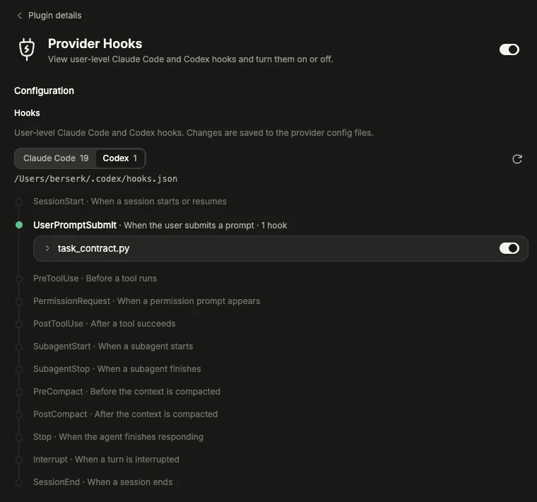

# Provider Hooks

A local BB plugin that shows user-level LLM provider hooks on a session lifecycle timeline, one provider at a time, with an on/off switch per hook. Open it from Settings → Provider Hooks.



## Behavior

- Claude Code: reads `hooks` from `~/.claude/settings.json`. Off removes the hook (and an emptied group or event key) and stores it with its position in plugin storage; on re-inserts it there. Other keys and indentation are kept; writes are atomic.
- Codex: reads `~/.codex/hooks.json`. Off sets `enabled = false` in `[hooks.state."<hooks.json path>:<event>:<group>:<hook>"]` of `~/.codex/config.toml`; on removes that line. Only that line changes.
- Shows event, matcher, type, command, and timeout. No project hooks, no Pi, no add/edit/delete.

Re-enabling several disabled Claude hooks out of the order they were disabled can place a hook at a neighboring position.

## Build and install

```sh
npm install
npm run test
npm run typecheck
bb plugin types --check
bb plugin build
bb plugin install . --yes
```

After edits, build and run `bb plugin reload provider-hooks`.
