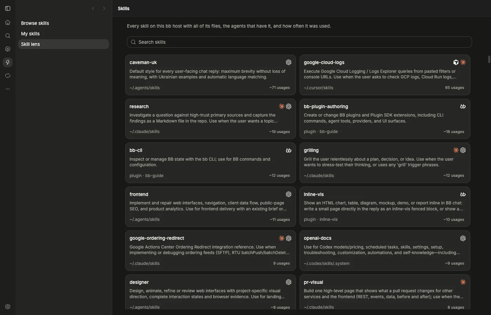
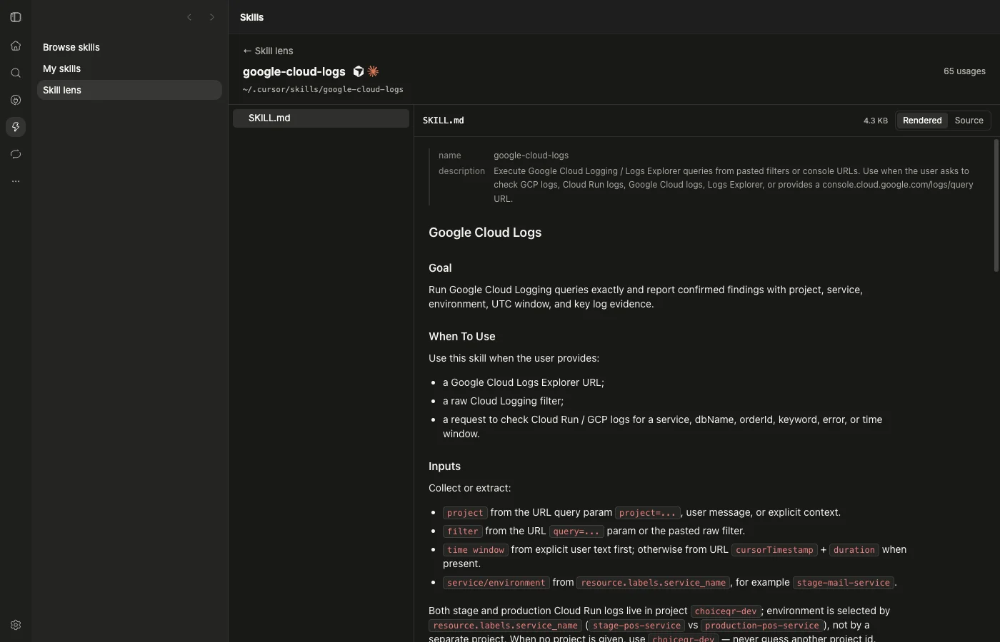

# Skill Lens

A local BB plugin that adds a Skill lens tab to the Skills screen, next to Browse skills and My skills. Every skill gets one card with the agents it is installed for, its source and how often it was used; a card opens the skill's files.





## Behavior

- Lists the skills `bb skill list` reports for the personal project. Entries with the same plugin and name share one card that shows every agent's logo; bb plugin skills show the bb logo.
- Sorts cards by usage, most used first, on the full list and in search results. Ties and the list before usage loads are sorted by name.
- Claude Code usage is exact: `Skill` tool calls (deduplicated by tool use id) and slash commands (deduplicated by message uuid) in `~/.claude/projects`.
- Codex usage is estimated from `SKILL.md` reads in tool calls and `<skill>` mentions in `~/.codex/sessions`, once per session. Cursor CLI usage is estimated from `SKILL.md` reads in `~/.cursor/chats/*/*/store.db`, once per chat. Estimated counts start with `~`.
- A read with an absolute path counts for the card whose folder it resolves to; a bare name counts for same-named cards of that agent. BB's `~/.bb/runtime/global-skills` copies count for the bb plugin skill.
- Usage is computed on the server and cached for 5 minutes.
- A card opens a page with the skill's file tree, Markdown rendered with a Source toggle and other text files as highlighted code. Symlinked folders and files open. When agents have the same skill in different folders, the page switches between them.
- Skips `node_modules`, `.venv`, `__pycache__` and `.git`, lists at most 2000 files, and shows no preview for binary files or files over 1 MB. Files are read-only.

Cursor IDE, Pi and Grok usage is not counted. BB's own thread events are not read, because they repeat what the Claude Code and Codex logs already hold.

## Build and install

```sh
npm install
npm run test
npm run typecheck
bb plugin types --check
bb plugin build
bb plugin install . --yes
```

After edits, build and run `bb plugin reload skill-lens`.

Requires BB >=0.46 and Plugin SDK >=0.6.37. The tab is placed into BB's Skills sidebar and main area through `experimental_appOverlay`, and the cards copy the markup of BB's Browse skills cards, so a BB update can require changes; `scripts/check-selectors.mjs` checks the selectors it relies on.
